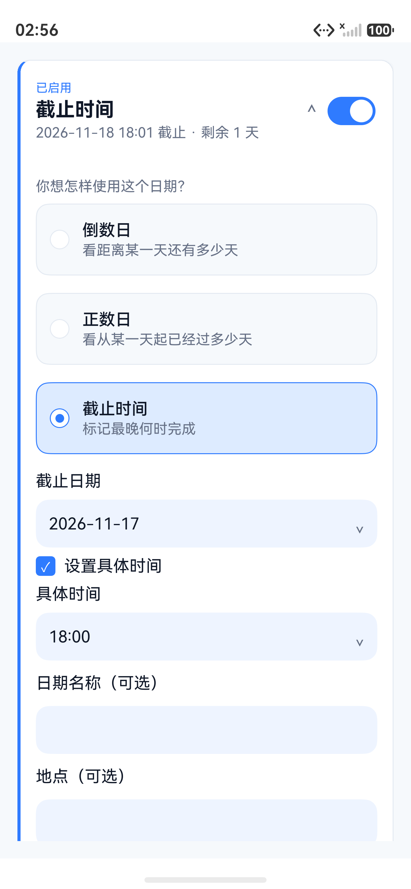

# ToDone 功能验收与产品评估

本轮执行于 2026-11-17 至 2026-11-18，基线为 `main@84d107c`。评估依据是当前产品规格、原生实现、模拟器实际操作、设备 preferences 快照和自动化结果。下文的改进方向属于评估建议，尚未成为产品决定。

2026-11-20 按用户决定更新任务分类。卡片完整体验、首页拖拽和悬浮交互进入后续功能完善，数据丢失与假成功优先作为 Bug 修复。本地已更新到 `f3a8ba6`，首页已有卡堆和底栏代码。下文操作证据仍对应 `84d107c`，当前待办与实现状态见 [TODO](../TODO.md)。

2026-11-20 在 `codex/matter-consistency` 完成 F01、F02、F03 的针对性修复和模拟器回归，新增验证见 [开发说明](development.md#2026-11-20-事项一致性修复验证)。下文保留原版本的评估与缺陷证据，不将其改写成本次全量验收。

## 结论

事项的基本创建与编辑、可选信息、草稿和一层引用已经形成可操作的流程。时间线已具备重复实例、日期浏览、跨日与重叠、标签和附件的较完整实现。

目前适合用隔离数据继续试用。作为长期保存个人信息的工具，已有能力的以下异常影响可信度。

1. App 与桌面卡片交替写入会覆盖已经保存的计数。
2. 详情记录、计数、勾选及部分编辑控件没有及时反映真实状态。损坏存档时，旧详情入口还会提示保存成功。

桌面汇总卡的三行内容和 2×4 布局、首页拖拽和大字体适配列入后续完善。全屏月历按钮属于已实现入口的异常，需在新版共用日历上复测。

V1 的 13 项要求已有大部分实现基础。进度应按数据可信度、核心流程和高频入口的可用程度判断，这些条件决定用户能否持续使用。

## 环境、方法与恢复

| 项目 | 本次证据 |
| --- | --- |
| 设备 | 已打开的 Pura 90 手机模拟器，HDC `127.0.0.1:5555`，1320×2856 |
| 系统 | `OpenHarmony-6.1.1.125`，API 24 |
| 应用 | `com.example.todone`，1.0.0，本机已有签名配置 |
| 构建 | `node scripts/verify.mjs --build` 增量构建通过，签名 HAP 1,646,509 字节 |
| 包校验 | SHA-256 `1fa76930158cd8fac50ff73b1e9ffcd34b98442fa496da970fe3a7fc7281ebf9` |
| 可移植测试 | Node 24.19.0，`node scripts/check-ci.mjs`，76/76 通过 |
| Demo | `node --test demo/web/model.test.mjs demo/web/theme.test.mjs`，10/10 通过 |
| Hypium | 临时副本补齐 DevEco 自带测试模块入口后，原有 5 项 MatterStore 测试在该模拟器通过 |
| 操作证据 | HDC 点击、原生滚轮、长按拖动、系统选择器、桌面卡片、布局树、截图、真实 preferences、结束进程后重读 |

测试前导出事项与草稿存档，核对 SHA-256，再用隔离测试数据执行创建、删除、重置和损坏存档实验。结束后恢复业务数据与原草稿，清除本轮测试日程、附件和系统截图。业务数据逐字段一致，草稿逐字节一致。

临时 `entry_test` 模块移除时，系统同时移除了应用桌面入口和原有三张卡片。已重新安装正式签名 HAP，按原位置恢复两张单事项卡、一张汇总卡。系统重新分配了卡片 ID，存档只更新这些绑定 ID。系统字号恢复“标准”，本轮允许的 ToDone 通知恢复“关闭”。原本未提交的构建配置保留。

原始布局、动作记录、存档备份和截图保存在本机临时验收目录 `C:\Users\13335\AppData\Local\Temp\todone-qa-20261117-1341`。包含用户原存档的备份留在本机。下列选录截图均使用隔离测试数据。

## 对照 V1 的逐项进度（84d107c）

| V1 要求 | 已确认的行为 | 当前缺口 |
| --- | --- | --- |
| 1. 创建、编辑、删除、归档 | 仅名称创建，改名后冷启动保留，归档/恢复，删除二次确认 | 新事项排在已有数据后面，首屏反馈弱。失败状态不一致 |
| 2. 首页列表 | 列表、搜索、归档筛选可操作 | 当前是传统列表。规格中的卡堆、吸附、悬浮四板块未在原生首页实现 |
| 3. 拖动排序 | 上移/下移后顺序持久化 | 拖动没有完成排序。源码放下逻辑调用成簇，缺少独立排序路径 |
| 4. 弱关联簇 | 数据逻辑 Hypium 通过，已有簇可显示 | 两组原生长按拖动实验没有生成簇，手势入口未通过 |
| 5. 创建时选信息 | 五个入口、按需展开、关闭后保留配置。禁用计数再启用保留初始值和流水 | 大字体没有出现规格约定的单列 |
| 6. 事件记录 | 点击产生真实时间戳，冷启动后可见 | 点击后记录列表不即时更新。缺少误记纠正入口 |
| 7. 计数 | 初始 5、步长 3，增加 3/每日一次/自定义 7 后冷启动累计 16 | 页面显示旧值。模式语义和“今日一次”的独立身份不清 |
| 8. 截止日期与倒计时 | 三用途切换。原生日期及分钟选择。18 日 18:01 保存并重开正确 | 选择框显示旧日期/时间，与摘要不一致 |
| 9. 备注 | 创建、编辑、持久化。键盘下实测输入仍可见 | 长文、中文长文本、外接输入、平板尚未穷举 |
| 10. 文字列表及一层引用 | 勾选落盘、关联已有事项、创建独立事项、打开、解除、删除主事项保留子事项 | 勾选、解除和新关联返回后显示旧列表。非法嵌套主要由业务测试覆盖 |
| 11. 单事项卡 | 实际添加、显示、记录和 +1、进入 App | 跨入口覆盖数据。同一事项的其他卡片没有同步即时刷新。打开回到 App 当前页面 |
| 12. 汇总卡 | 可以添加，选择数量写入存档 | 新旧卡均显示三行“未设置”。2×4 布局裁切。属性配置与副页未完成 |
| 13. 本地持久化 | 正常事项、草稿、引用及日程冷启动保留。时间线损坏报告错误并保留原文件 | 多写入入口覆盖。事项损坏静默载入示例。旧保存入口吞错 |

卡片验收状态统一见[服务卡片验证](widget-technical-validation.md)。本轮测试时首页为列表，后续 `f3a8ba6` 已通过 [HomeScreen](../app/entry/src/main/ets/components/HomeScreen.ets) 接入卡堆与底栏。当前按[首屏手册](ui-handbook/card-stack.md)继续完善，旧版结果保留作为测试记录。

## 实际操作覆盖与边界

### 事项

- 空名称提交被拦截。仅名称事项保存后通过搜索找到，结束进程后仍存在。
- 同一事项启用记录、计数、备注、文字列表、关联事项和日期，保存后可以进入详情。
- 系统日期从 17 日选到 18 日，时间从默认 18:00 选到 18:01，冷启动后详情正确。
- 倒数日与正数日当天文案分别为“就是今天”和“已过 0 天”。未来正数日等边界由业务测试覆盖，本轮未逐项在 UI 重复。
- 系统返回的关闭、保留草稿、放弃均操作过。保留后结束进程可恢复，放弃后重开为空，重新开始清空草稿。
- 自定义步长、初始值和每日一次落盘。连续两次“今日一次”只增加一笔。先点 +1 再点“今日一次”时，后者没有独立增加，符合当前按当天 value=1 判重的代码，产品含义需确认。
- 计数关闭、保存、再启用后，初始值 5、步长 3 和历史 3/1/7 保留，冷启动累计 16。
- 列表勾选、打开引用、解除引用，以及删除主事项后保留独立事项均核对了存档。界面刷新缺陷另列。
- 归档、恢复、搜索、按钮排序及其冷启动结果通过。两次删除确认和演示重置确认生效，重置事项没有清空独立时间线。
- 长按拖动已用 `uitest uiInput drag` 和 `uinput -T -g` 在两组可见事项上尝试，未完成排序或成簇。仍需人工触控和日志定位。
- 一次备注键盘输入可见且可保存。系统字号切到“特大”后冷启动，创建页仍为双列，随后恢复字号。

### 时间线

| 场景 | 实测结果 |
| --- | --- |
| 创建与独立性 | 空标题被拦截。新建日程出现在时间线，事项清单没有增加同名事项 |
| 周条与双日网格 | 周条左滑到下周保留星期。网格横滑逐日改变日期。纵向可滚动、点开便签 |
| 两级展开 | 首页和时间线均可通过下拉进入月预览、再下拉进入详细月历，系统返回保留选日 |
| 跨月 | 在 12 月选日后返回二级仍显示选中日期。回今天生效 |
| 全屏按钮 | 两次点击“全屏月历”未展开，同一位置从日期区下拉可以展开，按钮入口未通过 |
| 每日重复 | 连续日期生成实例，日期圈与预览显示安排 |
| 仅修改一次 | 18 日 16:00 移到 19 日 16:01，原日移除、目标日两段重叠可分别打开。重启保留 |
| 修改范围取消 | 从范围选择取消回编辑器，19 日、16:01 和附件修改保留 |
| 修改这次及以后 | 19 日起改名、改标签并取消提醒，旧段和新段分开保存 |
| 修改整个系列 | 对新系列改名生效 |
| 删除范围 | 单次跨日例外删除、这次及以后删除、整个系列删除均执行并核对存档 |
| 工作日/周/月 | 周六新建工作日组会首次顺延到周一。每周保存成功。31 日月重复在 1 月、3 月存在，在 2 月 28 日为空 |
| 跨午夜与分钟 | 23:37–次日 00:37 保存正确，改到 09:37–10:37，冷启动仍保留 37 分钟 |
| 起止选择 | 两端均能打开对应原生时刻滚轮。修改开始保留时长并更新结束 |
| 标签 | 默认标签、自定义色相及明暗、HEX `#2266AA` 操作并保存，冷启动后标签仍在 |
| 文件 | 从系统文件选择器选文本，冷启动后可通过系统预览读到正文 |
| 照片 | 从系统相册选择本轮测试截图，冷启动后可打开系统图片预览 |
| 音频 | 文件选择器识别 WAV 为音频并保存，系统预览只显示文件信息。播放未通过 |
| 网址 | 备注链接显示蓝色，点击实际文字打开浏览器并带入地址。网页加载成功未纳入结果 |
| 单次附件移除 | 移除改期实例的附件后，其他日期仍可打开原文本 |
| 普通日程删除 | 确认后移除日程，并清理无人引用的附件文件。“保留”按钮一次复测仍停留确认状态，需继续定位 |
| 后台提醒 | 获得通知授权，单次提醒保存后提示系统未接收全部提醒。退到后台 121 秒后跨过触发时刻，通知中心无通知，未通过 |
| 存档损坏 | 显示 `TL-JSON` 和重新读取入口，重复点重试仍保留错误及原文件。恢复正确文件并冷启动后可读 |

连续月历的中途反向、速度变化、逐帧跟手质量尚需人工触控验收。跨年、月末、旧数组迁移、损坏字段与附件兼容有 Node 测试，本轮未逐个做设备迁移实验。旧版网址附件、通知撤销后的旧时刻无重复通知、所有附件格式也未全覆盖。

平板只有配置文件，本机未下载 tablet 镜像，因此没有安装镜像或启动平板。物理设备、真实后台省电、屏幕阅读器、横竖屏、长时压力、磁盘满与 flush 失败注入仍待验证。

## 已复现现象与任务分类

以下按 2026-11-20 用户要求归入两类。Bug 优先级适用于已有能力的异常，功能完善沿用原编号追溯观察结果。修复与完善均待实施。

| 编号 | 类别与优先级 | 重现及影响 | 修复或完善方向与验收 |
| --- | --- | --- | --- |
| F01 | Bug / P1，优先 | App 保持打开，桌面卡片 +1，存档为 1。App 新建另一事项后存档变 0。再点卡片 +1，冷启动只剩 1，预期 2 | 统一写入所有权与提交边界，覆盖卡片注册、设置和业务数据。交替与同时写入时所有修改都保留 |
| F02 | Bug / P1，待新版复测 | 点击记录、计数、勾选、解除关联后存档变化，详情仍为旧值 | 页面订阅已提交状态。从真实按钮验证立即反馈、返回及冷启动一致。原观察中的卡片配置预览放入卡片完善清单 |
| F03 | Bug / P1，优先 | 损坏事项 JSON 后首页载入示例，详情“记录一次”提示“设置已保存”，原文件仍损坏、没有写入 | 显式报告读取失败，保留原快照并允许重试。统一详情、创建与卡片入口的提交结果 |
| F04 | 功能完善 | 新旧汇总卡均显示三行“未设置”，底部宣称 3 个事项，2×4 内正文和按钮超出卡片 | 随卡片功能补齐绑定与布局，按支持尺寸验证 0/1/3 个事项 |
| F05 | Bug / P2 | 日期摘要为 18 日 18:01，日期输入仍为 17 日，时间输入仍为 18:00 | 子编辑器与摘要读取同一状态。确认、取消、切换用途、重开均验证 |
| F06 | Bug / P2，待新版复测 | “全屏月历”按钮两次无反应，拖动入口成功 | 检查叠层 hit-test 与手势竞争。同一设备对比按钮和拖动的状态转换 |
| F07 | 功能完善 | 两组长按拖动不形成簇，也不排序。旧版放下逻辑只尝试成簇 | 随首页交互完善排序与成簇，补齐明确的落点、结果反馈和可逆整理 |
| F08 | 功能完善 | 系统特大字体下冷启动创建页仍为双列 | 补齐大字体、窄屏及平板布局，实测单列与可读性 |
| F09 | 功能完善 / 系统联调 | 提醒存档成功但系统拒绝接收，授权后单次后台测试无通知 | 核实代理提醒资格/名额，真机验证送达和撤销。确认应用缺陷后纳入 Bug |
| F10 | 功能完善 / 系统联调 | WAV 能保存与打开文件预览，但没有播放控件 | 验证支持格式与实际播放路径。确认应用缺陷后纳入 Bug |

F01 与 F03 使单纯替换数据库不足以自动解决问题。即便更换存储，旧内存快照覆盖、失败被吞掉和 UI 先报成功仍需明确处理。[事项存储](../app/entry/src/main/ets/store/MatterStore.ets)、[卡片写入入口](../app/entry/src/main/ets/entryformability/EntryFormAbility.ets)

复用业务操作、事务提交与幂等重试的具体设计及后续实现见 [数据一致性实现](data-model.md#数据一致性实现)。

F02 的假设来自 `changedTick` 与普通 store 查询的更新方式，F05 来自子组件与草稿字段更新路径，均需通过最小补丁后复测确认。F06 需要检查按钮叠层的命中。当前结论只确认复现现象，不把候选根因当成已修复结果。

### 选录证据

日期摘要与输入值冲突。

存档损坏后，旧详情仍显示保存成功。

新添加的 2×4 汇总卡三行未设置，底部内容越界。

时间线对损坏 JSON 显式报告错误。

## 从产品目的判断优点与缺点

### 应当保持的部分

**创建的最小成本低。** 只填名称即可保存，时间可选，后续增减信息不会改变事项身份。长期的“阅读”和临时的“带材料”可以使用同一种入口。这符合减少分类负担的理念。

**配置关闭后，历史仍有连续性。** 本轮计数关开实验保留了真实流水。用户能随着生活变化调整事项，这比要求先设计完整模板更适合个人工具。

**一层独立引用有明确价值。** 删除书单容器后，书本事项仍存在。容器与内容的生命周期分开，为以后复用资料留出了空间。当前保持一层约束也控制了理解成本。

**时间线开始建立可靠的实例语义。** 跨日修改仍记住原来的重复实例，删除这次不会错误删除目标日期的另一场日程。附件引用与清理、损坏文件保留、独立服务的失败结果都值得延续。

**工程边界开始有效。** 默认使用真实实现，业务代码可以脱离 SDK 测试，重要重复规则已有回归。这使复杂日程逻辑可检查，但 UI 和系统接口还需要同等力度的真实入口测试。

### 一直在附近讨论、但需要正面回答的问题

**1. 用户把信息交给 ToDone 后，是否可以停止记着“刚才到底保存了吗”？**

这是“持续记录个人信息”最基本的价值。现在用户必须通过退出重进确认数字，甚至卡片与 App 来回使用会丢掉一笔。应首先确立一次操作的可见结果、持久结果、重试结果、跨入口结果一致。之后再测录入快慢和视觉细节，才能知道产品是否减轻了记忆负担。

误点的纠正同样属于这一问题。当前记录能不断累积，但详情只查询最近 8 条记录，缺少完整历史与明确撤销入口。对长期健身、阅读、消费来说，“记错后怎么修正”会直接决定用户是否愿意继续记。最小验证可以只给记录/计数增加可追溯的撤销，不需要先做统计 Dashboard。

**2. 用户下一次打开事项，主要想看到什么？**

当前首页主要显示信息类别，详情排列全部已启用模块，桌面主属性按记录、计数、列表等固定优先级挑选。用户在规格中被赋予的“决定什么重要”，尚未体现在属性选择和高频动作上。给健身同时加记录与计数后，卡片会优先变成“记录”，这未必等于用户想要的动作。

可先用三个真实事项，让用户各选一个最重要的读数和一个常用动作，再验证是否能一眼读到、一次完成。复杂分页应根据次要信息的实际使用频率决定。

**3. 一个现实对象跨时间出现时，用户会不会被迫维护两个名字？**

事项和独立日程各自已能创建。如果“练琴”既长期记录练习次数，又想安排周三晚上的练习，现在需要维护事项与日程两套对象。是否出现重复命名、两个备注更新不一致、做完后再手动补记，需要用真实任务验证。

团队已明确暂缓卡片排入时间线，这个决定应继续保持。本轮建议先观察真实用例中的重复维护成本，再判断是否需要可选关联。一个待讨论的方向是让事项关联某次安排，并支持单独存在的日程。是否开发由团队决定。

**4. 有了大量事项以后，弱关联如何帮助用户重新找到它？**

弱关联簇表达“放在一起”，一层引用表达“某个列表中包含它”，时间安排表达“某次何时发生”。这三种关系有不同的用户意图。需要直接观察用户在 30～50 个事项中如何找回一个对象，而不能由“没有标签”推断检索已经简单。

当前大卡片加多排管理按钮，每屏能完整看到的事项很少。卡堆或吸附也可能继续降低同时可见数量。应使用同一批数据比较查找、扫读、快捷记录和整理四种任务，确认空间隐喻确实减少成本。

**5. 日期圈究竟帮助用户判断什么？**

当前单项固定四分之一圈，多项按类别占比排满一圈。它更接近当天安排构成的提示，不能单独表达绝对忙碌程度。十分钟会议和四小时长任务都可能点亮同样一段圈。若用户用它判断忙闲，需要同时读取总时长或一致的绝对量尺度。可先做两天不同总时长、相同比例的辨识实验，再决定图形。

**6. “可选模块”是否还会产生配置负担？**

只填名称很轻，但五个模块全开后表单较长，详情还保留“信息”等技术化标签及重复标题。应把首次捕捉、后续配置、高频记录分别看成用户任务，允许内容逐渐充实。轻量性需要由真实操作成本证明。

## 可以借鉴的经典问题

| 当前功能 | 相似问题 | 可以借鉴的部分 | 需要控制的扩展 |
| --- | --- | --- | --- |
| 计数与记录 | 流水账、库存变动 | 每次变动保留身份，汇总从流水派生，误操作可反向纠正 | 先用本地事务与操作 ID，无需引入重型事件系统 |
| 桌面卡片与 App | 多个入口共同修改一份状态 | 统一写入所有权、版本冲突与幂等重试，视图读同一份已提交数据 | 实际问题在单机也会出现，无需先做云同步 |
| 重复日程 | 日历标准中的系列、实例和例外 | 原始实例身份应在改期后保持，后续范围按原始序列解释 | 优先复用现有规则，不自行增加难以解释的新范围 |
| 列表引用 | 播放列表与独立媒体条目 | 移除引用与删除内容分别操作，关系可独立结束 | 继续保留一层限制 |
| 弱关联簇 | 书桌上的空间分组 | 可见邻近、可逆移动、明确反馈 | 模糊拖放必须有可发现的替代入口 |
| 汇总卡与日期圈 | 仪表读数与信息层级 | 用户先确定要读的量，系统再排版。显示与真实状态及时对应 | 由高频任务决定信息密度，避免默认加入更多指标 |

重复实例使用原始开始时刻识别、`THISANDFUTURE` 表达后续范围，已有正式日历语义可供校验。可以用这些规则核对现有实例身份和范围操作。[RFC 5545 §3.8.4.4](https://datatracker.ietf.org/doc/html/rfc5545#section-3.8.4.4)

操作后及时、明确地反馈系统状态，是直接相关的可用性原则。本轮“落盘了但数字不变”和“未写入却提示成功”分别破坏了这条原则。[Nielsen Norman Group 的系统状态可见性说明](https://www.nngroup.com/articles/visibility-system-status/)

## 下一步建议与可否证条件

| 顺序 | 建议 | 达成后必须能观察到的结果 |
| --- | --- | --- |
| 1 | 修复 F01/F03，建立统一的写入完成与失败语义 | App 与卡片交替创建、计数、归档后无覆盖。断开存储或损坏快照时有真实错误且原数据保留 |
| 2 | 修复 F02/F05，补真实入口的 UI 回归 | 记录、计数、勾选、关联、日期选择后，页面立即与落盘结果一致 |
| 3 | 后续更新补齐卡片与首页整理功能 | 实际桌面 0/1/3 个事项正确显示，支持尺寸内完整可读。拖动结果可预测并能解除 |
| 4 | 用少量真实事项连续试用 | 连续 7 天完成捕捉、记录、找回、修正、归档，记录误操作与重输，不以打开次数代替有效使用 |
| 5 | 再决定事项与日程的连接、卡堆和分页 | 同任务比较后确实减少重复录入、查找或操作成本，且没有强制日期或强制分类 |

2026-11-20 用户明确优先修复丢数与假成功，卡片与首页交互继续按后续完善推进。其余建议仍需试用验证。本报告记录 `84d107c` 的验收与评估，相关 Bug、功能完善和物理设备/平板验收由当前 TODO 跟踪。
