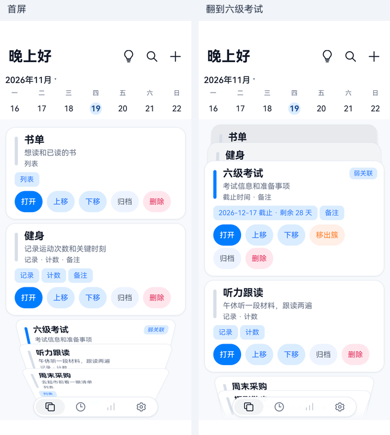
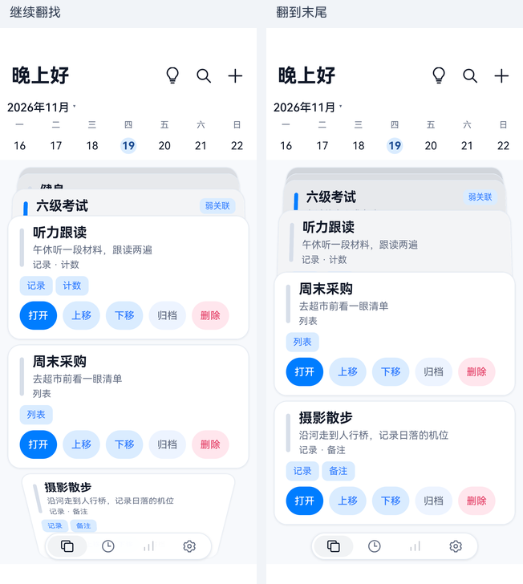

# 首屏 · 翻阅事项卡片

手机首页从清单前两项开始。顶栏和日历固定在应用顶部，中央两张相邻卡同时平铺。上推一张，原来的下张移到上排，下一张从下方卡叠进入。在清单中段，已看过的卡最多露出两张上沿。接近末尾后，已露出的卡沿会继续留在这叠牌里。前卡略宽，圆角压在后卡的纸面上。卡片沿用已有顺序和内容模板。

## 阅读、翻找与吸附

- **读和点。** 点任意一张的标题可进详情。上方露出的是原卡的卡头和色标。再推一张时，较近的后卡盖住最旧的卡，露出的卡头仍可直接点开。下方最多露出三层，越往下倾角越大。中央两张露出的按钮都能操作。排序、归档、恢复等操作只在底栏上方短暂提示结果，日期下的卡堆保持原有高度。
- **推和找。** 手指轻微晃动仍可点击，开始纵向拖动后整张卡跟随手指。从「健身」推到「六级考试」时，六级卡的上边缘盖过健身卡的操作、说明，最后只露出健身卡的上沿和标题。反向拖动前卡，能沿原路揭开同一张健身卡。长卡可以中途停读，继续推或反向拖动都沿着同一路径。
- **停和接手。** 慢拖优先留在已经选中的卡，明确推过两张之间的分界才翻页。快推能稍早吸附到眼前的下一张；长拖可以连续经过多张。松手收拢途中可以按住，再向任意方向拖动。
- **翻到末张。** 「周末采购」和「摄影散步」一起摊平，后者的底边停靠在导航胶囊上方。再上推时，日历下的整叠卡片会带着阻力往上走一小段。采购卡和摄影卡之间的空隙保持原宽，上方露出的卡沿也等距上移，松手后一起回位。上方「听力跟读」能露出摘要，更早的事项逐层露出标题或卡边。回位过程中可以按住卡片接着拖。窄屏或长卡放不下时，先读到倒数第二张的操作行，再推到末张的卡尾。清单只有两张且放得下时，首屏就能直接操作两张。
- **翻找时用日历。** 在卡面起手只移动卡堆，顶栏、选中日期和日历下边缘始终在原处。可以直接在日期区选日或展开月历。点底栏的卡片图标可回到清单开头。

演示清单在「健身」「六级考试」「书单」后增加「课程汇报」「听力跟读」「周末采购」「摄影散步」。已有数据时，点放大镜，再点「补充示例」，只追加缺少的示例。已改名或归档的示例保留原状。

旧版的[三帧效果图](assets/card-stack.png)记录了居中翻页的原始构想。当前版本使用上面的推牌与点按约定。

## 共用顶栏与日期

顶栏右上角从左到右是灯泡（提示）、放大镜（搜索）、加号（添加）。卡片和时间线共用这组按钮的位置、图形、间距和操作。

日期条默认显示当周七天。从日期条下拉并松手，停在二级月历预览。今天有醒目标记，重要节日在对应日期旁用小字标注。月历下方保留所选日期的事项小窗口；点选另一天时，窗口随之更新，月历保持展开，今天的标记也仍可辨认。在 Timeline 中，月历和小窗合计约占顶栏下方的 55%，下面始终留着可操作的双日网格。上滑月历，沿原路收回到选中日所在的一周。从「事项」首页或「时间线」都能进入三级全屏详细月历。在二级继续下拉或点「全屏月历」，原有日期格展开至顶栏下方。拖动时日期圈逐渐收回，格线和日程条渐显；三级保留顶栏，节日、节气或农历显示在日期下方。上滑收回到二级时保留选中日期及其事项预览。

卡片页保留日期数字、今天和选中底色。切到时间线时，顶栏和日期条仍在原位，选中日、正在浏览的月份和展开层级沿用卡片页的状态。时间线中，有安排的日期在数字外侧绘制分段圆环，从十二点方向顺时针排列。色段两端为圆头，段与段之间留出空隙，极短的类别以圆点呈现。空日期只显示数字；选中日期在数字下方加浅色圆底。只有一项安排时，默认以该事项的类别色画四分之一圈（90°）。有多项有时长的安排时，彩色部分按各类别的时长占比分段。例如学习 90 分钟、运动 30 分钟，两段弧长之比为 3∶1。Timeline 本轮先将多项排满一圈（保留间隙），同标签合并，超过六类时保留时长最长的五类，其余以灰色合并。当天的完整事项仍可在小窗中查看。跨午夜的安排按落在各日的实际时长分别计算。全天或无时长事项的规则待定。

## 悬浮底栏

白色胶囊水平居中，贴近系统底部安全区。胶囊高 38 vp，常规手机上宽度占屏幕的 65%。四个入口各自保留 44 vp 高的触控区。卡堆从日期条下方一直铺到胶囊背后。常规手机第三张应在胶囊上方露出可辨认的标题。

| 从左到右 | 卡片 | 时间线 | 复盘 | 设置 |
| --- | --- | --- | --- | --- |
| 图标 | 两张叠放的卡片 | 时钟 | 柱状图 | 齿轮 |

这版用四个等距图标，当前板块的图标颜色最深。按钮的无障碍名称使用对应的中文板块名。本轮复盘图标禁用，设置可切换并提供原有的桌面服务卡片入口。

## 原型核对

1. 在周历下看首屏，直接打开第二张。在清单中段翻卡，核对日历上下边缘位置相同、上方仅余最近两条标题。分别点开上方标题和中央卡，返回后反向推，核对较早的标题重新出现。
2. 停在「六级考试」，看「书单」和「健身」的下半部是否都被盖住。慢慢把六级卡往下拖，会依次看见健身卡原有的说明和操作。在半途反推，观察前卡上边缘沿原路盖回，并从分界两侧松手核对落点。
3. 从倒数第四张开始慢推，观察已经露出的旧卡能否继续留在后面。推到末尾，分别点开最后两张并返回。在终点再上推一小段并停住，观察上方卡沿、采购卡和摄影卡是否一起上移，日期和底栏是否固定，松手后整叠是否回到原处。再试一次，中途改向或在回位时按住，继续往前翻。在窄窗或大字号下试长卡，核对两张的操作行都能读到。点底栏卡片图标回开头。
4. 用示例事项测试排序、归档，在搜索区的归档清单里恢复它。每次检查底部只提示本次操作，约两秒后消失，日期和卡区上边缘固定。删除和重置仍需再次点确认按钮。
5. 选一个非今天日期，切到时间线，再切回卡堆。核对日期、展开层级和两边的底栏。双日网格和事项详情见[时间线](timeline.md)。
