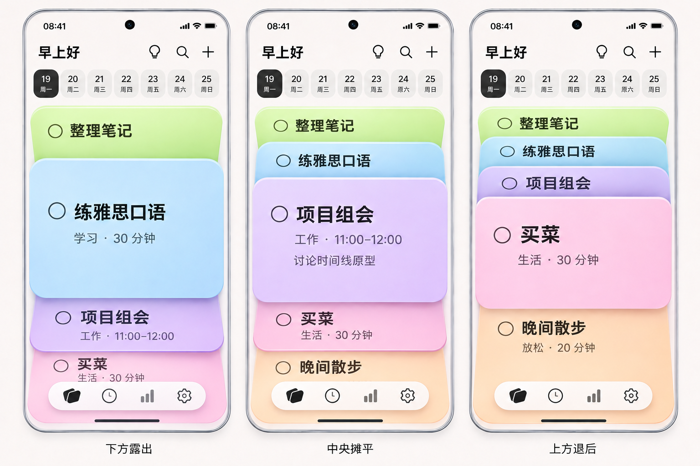

# 首屏 · 翻阅事项卡片

一张卡对应清单中的一件事项。下图从左到右记录同一次向上翻阅，紫色的「项目组会」先从下方露出，在中央摊平，最后退到「买菜」后面。

## 翻阅与吸附

拖动卡堆时，卡片按清单顺序经过内容区的水平中线。卡面绕水平轴前后倾斜，靠近中线时倾角线性减小。到中央时卡面正对用户，四个圆角和整张卡的内容都可见。继续拖动，卡片越过中线，逐渐倾斜并被下一张遮住一部分。前后两张各露出能辨认事项的区域。

手指松开的一刻，取卡片中心到中线的垂直距离最小的那张，让它轻轻吸到中央并摊平。原型核对时，可以在「项目组会」和「买菜」之间松手两次，每次让不同的一张更靠近中线，检查最终居中的是否都是较近的那张。

## 共用顶栏与日期

顶栏右上角从左到右是灯泡（提示）、放大镜（搜索）、加号（添加）。卡片和时间线共用这组按钮的位置、图形、间距和操作。

日期条默认显示当周七天。从日期条下拉并松手，停在二级月历预览。今天有醒目标记，重要节日在对应日期旁用小字标注。月历下方保留所选日期的事项小窗口；点选另一天时，窗口随之更新，月历保持展开，今天的标记也仍可辨认。在 Timeline 中，月历和小窗合计约占顶栏下方的 55%，下面始终留着可操作的双日网格。上滑月历，沿原路收回到选中日所在的一周。从「事项」首页或「时间线」都能进入三级全屏详细月历。在二级继续下拉或点「全屏月历」，原有日期格展开至顶栏下方。拖动时日期圈逐渐收回，格线和日程条渐显；三级保留顶栏，节日、节气或农历显示在日期下方。上滑收回到二级时保留选中日期及其事项预览。

有安排的日期在数字外侧绘制分段圆环，从十二点方向顺时针排列。色段两端为圆头，段与段之间留出空隙，极短的类别以圆点呈现。空日期只显示数字；选中日期在数字下方加浅色圆底。只有一项安排时，默认以该事项的类别色画四分之一圈（90°）。有多项有时长的安排时，彩色部分按各类别的时长占比分段。例如学习 90 分钟、运动 30 分钟，两段弧长之比为 3∶1。Timeline 本轮先将多项排满一圈（保留间隙），同标签合并，超过六类时保留时长最长的五类，其余以灰色合并。当天的完整事项仍可在小窗中查看。跨午夜的安排按落在各日的实际时长分别计算。全天或无时长事项的规则待定。

## 悬浮底栏

白色胶囊水平居中，悬在系统手势区上方。卡堆从日期条下方一直铺到胶囊背后，胶囊两侧也能看到卡片底色。左图下方的「买菜」标题完整露在胶囊上方。

| 从左到右 | 卡片 | 时间线 | 复盘 | 设置 |
| --- | --- | --- | --- | --- |
| 图标 | 两张叠放的卡片 | 时钟 | 柱状图 | 齿轮 |

这版用四个等距图标，当前板块的图标颜色最深。按钮的无障碍名称使用对应的中文板块名。复盘和设置的页面内容另行设计。

原型核对时，把清单中的第一张、中间一张和最后一张依次滑到中央，检查每一张的四个圆角和卡内文字是否完整露出。再选中 19 日，从底栏点「时间线」，核对时钟图标是否显示为选中态、顶栏和日期条是否仍在原位，以及网格是否从 19 日开始并排显示两天。双日网格和事项详情见[时间线](timeline.md)。

图中的类别、时间和备注是示例。下一轮讨论单张卡片摊平时的信息顺序，以及叠在相邻卡片后面时应该露出哪些内容。
