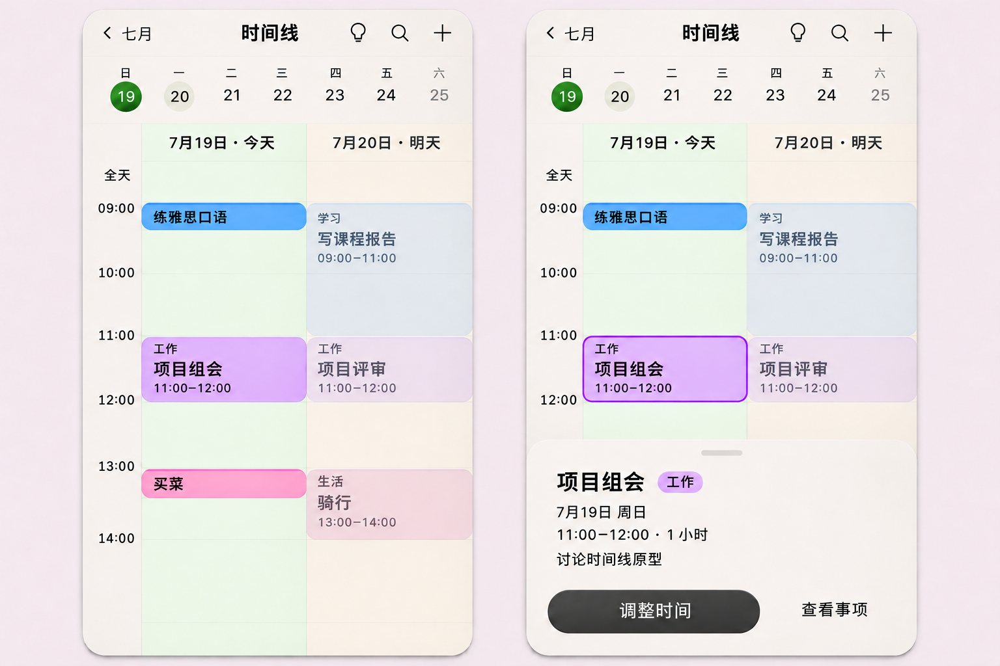
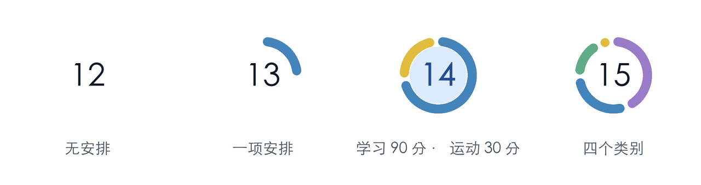

# 时间线 · 双日浏览与事项详情

**设计冻结 v1 · 2026 年 11 月 13 日。** 本页和[添加面板定稿](event-fields.md#时间线添加面板)作为 HarmonyOS NEXT 第一版的开发基线。双日布局、半屏详情和卡片排程以本页的效果图与验收样例为准；添加、选日、滚轮、标签和输入焦点可直接打开[冻结的交互原型](assets/timeline-editor-v1.html)试用。原型的保存结果仅在当前页面内保留。原生首个切片从首页「时间线」进入，已接入独立时间块及双日网格。下一步验证见[当前任务](../../TODO.md)。

### 开工与第一项验收

建议先跑通一条真实数据路径：从时间线「＋」创建今天 14:00–15:00 的「项目组会」，在双日网格点开并改到 15:00–16:00，结束进程后重开。应只看到改期后的一个时间块，卡片清单中不会多出同名事项。若存储失败，保留草稿并允许重试，重试成功后也只保留一条。随后接入卡片关联、取消安排和拖放，按下方排程样例验收。

重复日程点开后显示这一次的日期和时段。点「编辑日程」修改所选那一次，点保存再选作用范围。仅修改这一次会保留其他日期，修改这次及以后会从选中日拆分系列；点「删除日程」可选择仅这一次、这次及以后、整个系列，默认选中仅这一次，确认后生效。跨午夜日程以实际开始的那次为准。保存或删除后，当前周和月历中受影响的日期圈随之刷新。日程支持相对开始时间的系统提醒和备注附件。改期提醒送达、重启后附件打开仍待实机核验。多项安排暂用整圈按标签时长比例分配，日期圈与事项便签共用标签色。手势参数和忙闲阈值留待试用。

## 效果图

图中假设 7 月 19 日为今天。看 11:00 这一行，今天的「项目组会」和明天的「项目评审」都是工作事项，两张紫色便签在日期中线相接。看 12:00 后的空档，可以单独辨认各列的忙闲底色。

## 页面结构

| 区域 | 内容与布局 |
| --- | --- |
| 顶部导航 | 月份显示当前选中日所在年月。周条左右滑动翻周，保留星期；轻点某日切换日期。通过首屏切换时沿用[共用顶栏和日期条](card-stack.md)，右上角依次为提示、搜索、添加，时间线从选中的日期展开。 |
| 日期列头 | 每列用一行显示日期和相对日期，如「7月19日 · 今天」。在双日网格左滑前进一天，右滑后退一天，后一天在右列。翻到下周时两列显示各自的日期与星期。全天事项在各自列头下方、小时网格上方单独占一行。 |
| 时间网格 | 纵向浏览早晚时段，左侧共用一条小时刻度，同一时刻在两列水平对齐。空档保留相应高度，方便比较两项安排之间的可用时间。 |
| 事项便签 | 单独的便签铺满日期列；时段重叠的便签在同一列内并排，每张都能点开。名称与起止时刻贴着左上内边距排列。上沿使用比填色深一级的同色系细线；两段同色日程紧邻时也能辨认交界。 |
| 底部导航 | 在首屏内浏览时间线时沿用[四项悬浮底栏](card-stack.md#悬浮底栏)，第二项时钟图标显示为选中态。 |

便签的上沿对应开始时刻，下沿对应结束时刻。如果一小时的显示高度为 H，30 分钟占 H/2，2 小时占 2H。空间紧时只显示标题，如「练雅思口语」。较高的便签可以再显示类别和起止时刻。文字取舍以实际可用高度为准。

## 配色与日期状态

| 视觉元素 | 表达的含义 | 开发时核对 |
| --- | --- | --- |
| 日期列底色 | 当天忙闲。已安排事项占用的时间比事项数量权重更高。 | 底色从列头延伸至空档，便于比较两天的忙闲。样图中，较空的一天用浅绿，较满的一天用淡暖色。 |
| 便签色相 | 事项类别。样图用蓝色表示学习、紫色表示工作、粉色表示生活。 | 同类事项跨日仍能凭色相辨认。独立日程沿用用户选中的标签色，样图的名称和具体配色是示例。 |
| 便签填充与文字 | 今天的事项更醒目，未来的事项仍可预览和调整。 | 今天填色较实，标题和时间对比鲜明。未来的填色更透、饱和度更低，类别标记、标题和时间一起减弱。日期网格和空档仍清楚显示忙闲底色。日期成为今天时，切换到今天的样式。 |

## 选中事项

轻点便签，选中描边沿原来的圆角轮廓显示，底部展开半屏详情。面板呈现完整标题、类别（如有）、日期、起止时刻、持续时长和备注（如有）。独立日程的开始、结束时刻可直接点按，编辑页在对应时刻下方打开滚轮。右上角「编辑日程」可改标题和备注；底部「删除日程」需要确认。关联卡片的便签提供「查看事项」和「取消时间安排」；收起面板后回到原来的日期和时段。

## 把卡片排进时间线

本节保留设计稿供团队会议讨论，开发暂缓。

1. 长按「图书馆学习」卡片，拖到悬浮底栏的时钟图标并短暂停留。时间线打开在当前选中的日期，手指可继续拖向目标刻度。
2. 落点决定开始时刻，松手前预览日期和起止时间。若卡片已有安排，同时显示原时段和候选时段。松手后在新位置显示同一事项，原位置腾空；中途取消拖动时保留原安排。
3. 拖便签上沿改开始，拖下沿改结束。也可以直接点卡片的「安排时间」输入日期和起止时间。两种入口共用一个时段，从任一侧改期后在另一侧能看到相同结果。

时间线右上角「＋」从底部拉起新建面板，日期沿用选中日，填写名称、开始和结束即可保存独立时间块。常用标签在首层选取，重复、提醒各有入口，附件在备注区添加，见[时间线添加面板](event-fields.md#时间线添加面板)。

## 原型核对样例

| 类别 | 今天 · 7 月 19 日 | 明天 · 7 月 20 日 |
| --- | --- | --- |
| 学习 | 09:00–09:30 练雅思口语 | 09:00–11:00 写课程报告 |
| 工作 | 11:00–12:00 项目组会 | 11:00–12:00 项目评审 |
| 生活 | 13:00–13:30 买菜 | 13:00–14:00 骑行 |

用同一组数据请试用者指出哪天更满、今天 09:30 到组会前有多长空档，以及明天的「项目评审」几点开始。预期分别为明天、90 分钟、11:00。再请试用者点开「项目组会」，把结束时刻延后 15 分钟。记录第一次点在哪里，有没有把未来事项误读为不可操作。

### 排程验收样例

| 试走操作 | 预期结果 |
| --- | --- |
| 把带三项清单的「图书馆学习」拖到周四 13:00，拉下沿至 16:00，从便签打开原卡并勾选一项。 | 卡片显示周四 13:00–16:00，返回卡堆能看到刚才的勾选。 |
| 将同一卡片再次拖到周五，落下前核对改期预览。随后从卡片用「安排时间」修改开始时刻。 | 周四原时段腾空，周五只有一张关联便签；修改后的起止时间在两处一致。 |
| 在便签上选「取消时间安排」；再从时间线「＋」建一段独立组会并删除。 | 学习卡、清单勾选、模块及已有截止日期均保留。独立组会只出现在时间线，删除后学习卡仍可打开。 |
| 同日安排 13:00–16:00 学习和 15:00–17:00 组会；另试 23:30–次日 00:30。 | 前两张便签并排，都能点开，当天覆盖 4 小时；跨日时段在两列各显示和计入 30 分钟。 |

## 原型待验证

用手机核对时钟图标的停留时间、拖动吸附精度、未排卡片首次落点的建议时长，以及短便签上下沿是否容易抓取。忙闲底色的分档阈值、全天对忙闲的影响和缩放需求仍待试用。

原生时间线中，无标签的日程以蓝色显示。标签色显示在便签的浅色填充、深色顶沿、详情以及日期安排圆环。下拉时选中周原位展开，月历与事项小窗合计约占顶栏下方内容区的 55%。双日网格随手指下移，原有滚动位置在展开和收回时保留。二级点日期，小窗只列当天事项，空日显示「这天暂无安排」；下方两列显示所选日及次日，可滚动并点开便签。横滑月历可翻月，「回今天」重新选中今天。上滑月历收回到选中周。在二级从月份或日期区域继续下拉，原有日期格随手指长高，直到铺满顶栏下方。松手前即可拉满，途中反向时沿原进度收回。日期圈朝起点缩短，完全展开时消失。细灰格线和日期下方的节日、节气或农历小字渐显，日程条使用标签色衬底，与格线留出空隙。标题依据底色明暗使用对比清晰的文字。点月份旁的「全屏月历」也可展开。三级上滑或按系统返回键回到二级，预览和双日网格跟随选中日。小屏日期区或较长的预览列表可先滚动，到顶部可下拉进三级，到末尾可上滑回周视图。编辑日程的选日面板继续支持上下翻月。3 小时、6 小时是日期底色的分界。这些初值和网格小时高度在[网格组件](../../app/entry/src/main/ets/components/TimelineGrid.ets)集中调整。选中日与草稿由页面和编辑器持有，拨动滚轮只更新草稿，点保存才提交存储。

时间线的产品约定见[产品规格](../../PROJECT_SPEC.md)第 12 节，试用方法见[设计原则](../design-principles.md)。
